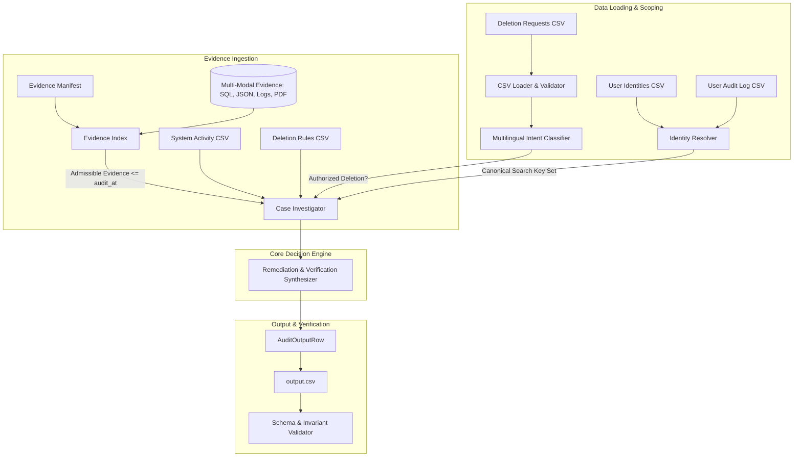
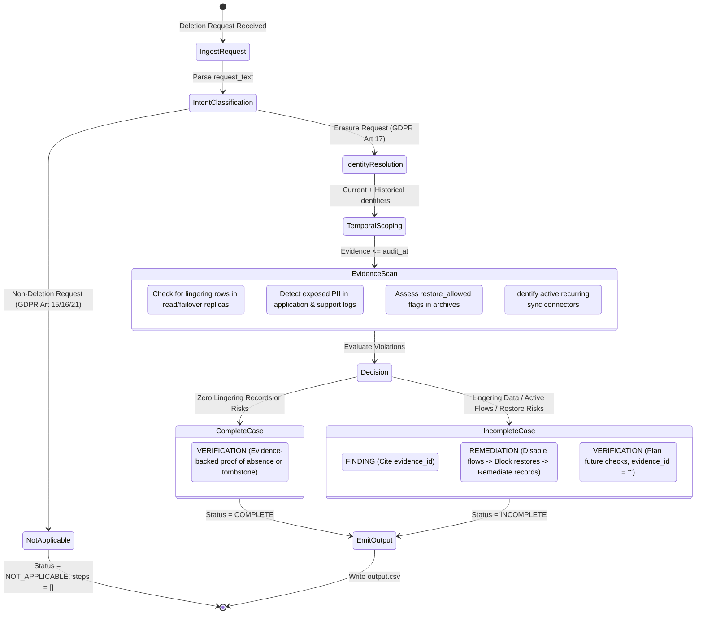
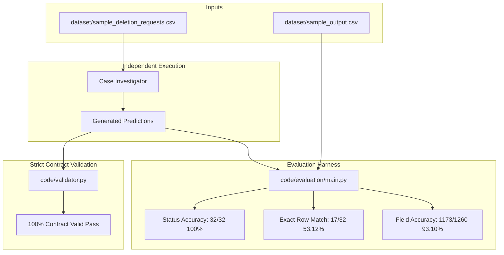

# Ghost Data Detector

**An Evidence-Grounded Deletion Auditing Engine for Distributed Systems**

[](https://www.python.org/downloads/)
[](LICENSE)
[](code/tests/)

---

## Portfolio & Independent Release Notice

> **Note**: This repository represents an independent software engineering portfolio project based on the architectural problem modeled in HackerRank Orchestrate (October 2026), "Ghost Data Still Exists". The October competition submission was not completed; this codebase represents an independent, refactored implementation, evaluation, and documentation release.

---

## 1. Problem Statement

When an enterprise customer requests personal data deletion under GDPR Article 17 ("Right to be Forgotten") or CCPA, the deletion workflow may return a status of **`COMPLETE`**. However, in modern distributed microservice platforms, personal data frequently persists:

- **Replication Drift**: Deletions applied to primary databases may fail to replicate to regional read replicas, failover snapshots, or reporting databases.
- **Active Data Flows**: Recurring ETL jobs, data warehouse connectors, or event consumers may copy or recreate deleted data downstream.
- **Restore & Backup Revival**: Unblocked database backups and point-in-time recovery archives can revive previously deleted customer records upon restoration.
- **Exposed PII in Tombstones**: Account tombstones intended to preserve internal referential integrity may inadvertently expose direct PII (emails, names, phone numbers) in logs, support tickets, or export manifests.
- **Historical Identifier Disconnect**: Customers often request deletion using current email addresses, while older systems continue storing records under former emails, phone numbers, or pseudonymized hashes.

Workflow status claims and service responses are merely **claims**. True compliance requires establishing the factual state of personal data across all evidence up to an exact temporal audit cutoff.

---

## 2. Project Goals & Scope

- **Evidence-Grounded Auditing**: Decide deletion completeness strictly based on participant-visible evidence rather than trusting reported status claims.
- **Historical Identity Reconstruction**: Automatically trace change logs to discover every historical email, phone number, and hash ever linked to an account.
- **Multi-Modal Verification**: Ingest and audit SQL database replicas, JSON snapshot bundles, application and gateway logs, and PDF records.
- **Deterministic Remediation Formulation**: When deletion is incomplete, generate an ordered remediation plan (disabling flows and blocking restores before modifying data) followed by post-remediation verification checks.
- **Strict Contract Compliance**: Guarantee 100% adherence to competition schemas, phase orderings, step operations, and serialization constraints.

---

## 3. Features Implemented

- **Regulatory Intent Classifier**: Multilingual classification distinguishing GDPR Art 17 erasure requests from Art 15 access/export, Art 16 rectification, and Art 21 marketing opt-out exceptions.
- **Identity Resolver**: Graph traversal of `user_audit_log` to resolve subjects across current and historical identifiers.
- **Multi-Modal Evidence Index**:
  - In-memory SQLite execution (`:memory:`) to inspect relational replica drift.
  - JSON and plain-text streaming parsers for export manifests and support handovers.
  - Regex-based trace log analyzers for read/write traces and exposed PII.
  - PDF document text extraction via `pypdf`.
- **Temporal Cutoff Enforcer**: Inclusive timestamp comparison ensuring evidence captured after `audit_at` is never evaluated for that case.
- **Dependency-Ordered Remediation Engine**: Formulates safe remediation sequences (`DISABLE_DATA_FLOW` $\to$ `BLOCK_RESTORE` $\to$ `DELETE_RECORD` / `REDACT_RECORD` / `ANONYMIZE_RECORD`).
- **Contract Validator**: Comprehensive schema and invariant validator enforcing 1-indexed steps, valid phase progressions, and correct `evidence_id` grounding.

---

## 4. Architecture Overview



---

## 5. Deletion Investigation Lifecycle



---

## 6. Validation and Evaluation Pipeline



---

## 7. Technology Stack

- **Language**: Python 3.11+
- **Standard Library Modules**: `dataclasses`, `sqlite3`, `csv`, `json`, `pathlib`, `re`, `argparse`, `datetime`
- **Third-Party Dependencies**:
  - `pypdf >= 3.0.0`: PDF text extraction from legal retention registers and invoices.
  - `pytest >= 7.4.0`: Automated unit, regression, and adversarial test execution.

---

## 8. Repository Structure

```text
.
├── README.md                      # Project documentation and architectural overview
├── LICENSE                        # MIT License
├── CONTRIBUTING.md                # Development, contribution, and code guidelines
├── SECURITY.md                    # Security, privacy, and vulnerability disclosure policy
├── requirements.txt               # Python package dependencies
├── .gitignore                     # Git ignore rules for caches, envs, and temporary files
├── output.csv                     # Candidate audit predictions for all 518 evaluation cases
│
├── code/                          # Production source code
│   ├── __init__.py
│   ├── classifier.py              # Multilingual intent classification
│   ├── evidence.py                # Multi-modal evidence indexing (SQL, JSON, logs, PDF)
│   ├── identity.py                # Multi-identifier resolution and audit history traversal
│   ├── investigator.py            # Case investigation, finding detection, and remediation planning
│   ├── loader.py                  # CSV loading with strict schema validation
│   ├── main.py                    # Primary CLI entry point
│   ├── models.py                  # Immutable domain models and contract invariants
│   ├── replay.py                  # Deterministic sample output comparator
│   ├── timestamp.py               # ISO-8601 parsing and temporal cutoff comparison
│   ├── validator.py               # Competition contract schema and step validator
│   ├── evaluation/
│   │   ├── main.py                # Independent evaluation harness
│   │   └── evaluation_report.md   # Detailed audit evaluation report
│   └── tests/                     # Test suite (35 automated tests)
│       ├── test_milestone1.py     # Replay and loader regressions
│       ├── test_milestone2.py     # Baseline slice regressions & independence test
│       ├── test_milestone3.py     # Distributed trace correlation and step envelope scoping
│       ├── test_milestone4.py     # Adversarial boundaries, isolation, and contract invariants
│       └── test_milestone5.py     # Multilingual intent and exposed PII log inspection
│
├── docs/                          # In-depth technical documentation
│   ├── architecture.md            # Detailed module responsibilities and component design
│   ├── investigation-workflow.md  # Step-by-step investigation lifecycle and remediation order
│   ├── evaluation.md              # Benchmarks, accuracy metrics, and adversarial test cases
│   ├── limitations.md             # Technical trade-offs, unobservable state, and future roadmap
│   └── linkedin-project-post.md   # Showcase summary and key engineering lessons
│
└── examples/                      # Safe, synthetic examples for offline demonstration
    ├── README.md                  # Synthetic fixtures guide
    ├── run_example.py             # Standalone synthetic runner script
    └── synthetic_data/            # Fully fictional synthetic data files
```

---

## 9. Installation & Setup

### Prerequisites
- Python 3.11 or higher
- Git

### Quick Setup

```bash
# 1. Clone the repository
git clone https://github.com/aaryan2720/Ghost_data_detector.git
cd Ghost_data_detector

# 2. Create and activate a virtual environment
python -m venv .venv
# On Windows:
.venv\Scripts\activate
# On Linux / macOS:
source .venv/bin/activate

# 3. Install dependencies
pip install -r requirements.txt
```

---

## 10. CLI Usage

The primary entry point is `code.main`:

### 1. Run Independent Investigation
Generate predictions for any deletion requests file:

```bash
# Investigate evaluation dataset (writes output.csv)
python -m code.main --mode investigate --requests dataset/deletion_requests.csv --output output.csv

# Investigate synthetic examples
python -m code.main --mode investigate --requests examples/synthetic_data/deletion_requests.csv --output examples/synthetic_output.csv --dataset-dir examples/synthetic_data
```

### 2. Validate Output Contract
Validate schema, ordering, and grounding invariants on any generated output file:

```bash
# Validate full evaluation output against expected cases
python -m code.main --mode validate --output output.csv --expected dataset/deletion_requests.csv

# Validate synthetic output
python -m code.main --mode validate --output examples/synthetic_output.csv --expected examples/synthetic_data/deletion_requests.csv --dataset-dir examples/synthetic_data
```

### 3. Evaluate Independent Prediction Accuracy
Evaluate generated predictions against ground truth without data leakage:

```bash
python -m code.evaluation.main --mode investigator
```

### 4. Run Synthetic Demonstration
Execute the self-contained synthetic fixture runner:

```bash
python examples/run_example.py
```

---

## 11. Input and Output Contract

### Input Schema (`dataset/deletion_requests.csv`)
```text
case_id,email,requested_at,reported_status,reported_at,audit_at,request_text
```

### Output Schema (`output.csv`)
```text
case_id,deletion_status,steps_json
```

- **`case_id`**: Matches input case ID exactly, sorted in ascending order.
- **`deletion_status`**: One of `COMPLETE`, `INCOMPLETE`, or `NOT_APPLICABLE`.
- **`steps_json`**: Valid JSON array of step objects. Empty `[]` for `NOT_APPLICABLE`.

### Step Object Schema
```json
{
  "step_no": 1,
  "phase": "FINDING",
  "system_id": "account_service",
  "resource_id": "account_005",
  "operation": "REPORT_REMAINING_RECORD",
  "state": "PRESENT",
  "evidence_id": "evidence_01"
}
```

### Allowed Operations and States

| Phase | Operation | Allowed State | Meaning |
|---|---|---|---|
| `FINDING` | `REPORT_REMAINING_RECORD` | `PRESENT` | Lingering record surviving in database or replica. |
| `FINDING` | `REPORT_EXPOSED_PII` | `PRESENT` | Direct identifiers exposed in tombstone or logs. |
| `FINDING` | `REPORT_ACTIVE_DATA_FLOW` | `ACTIVE` | Active connector or sync process can recreate data. |
| `FINDING` | `REPORT_RESTORE_RISK` | `ACTIVE` | Unblocked backup archive can restore deleted data. |
| `REMEDIATION` | `DISABLE_DATA_FLOW` | `DISABLED` | Halt active connector or export job. |
| `REMEDIATION` | `BLOCK_RESTORE` | `BLOCKED` | Prevent affected backup from restoring user data. |
| `REMEDIATION` | `DELETE_RECORD` | `ABSENT` | Drop record completely from database or replica. |
| `REMEDIATION` | `REDACT_RECORD` | `REDACTED` | Strip direct PII while preserving compliant tombstone. |
| `REMEDIATION` | `ANONYMIZE_RECORD` | `ANONYMIZED` | Irreversibly unlink analytics record from user. |
| `VERIFICATION` | `VERIFY_RECORD_ABSENT` | `ABSENT` | Confirm record no longer exists. |
| `VERIFICATION` | `VERIFY_RECORD_PRESENT` | `PRESENT` | Confirm policy-required legal record remains intact. |
| `VERIFICATION` | `VERIFY_RECORD_REDACTED` | `REDACTED` | Confirm required PII fields were stripped. |
| `VERIFICATION` | `VERIFY_RECORD_ANONYMIZED` | `ANONYMIZED` | Confirm record can no longer be linked to user. |
| `VERIFICATION` | `VERIFY_DATA_FLOW_DISABLED` | `DISABLED` | Confirm data flow is inactive. |
| `VERIFICATION` | `VERIFY_RESTORE_BLOCKED` | `BLOCKED` | Confirm backup restoration is blocked. |

---

## 12. Testing & Verified Results

Execute the complete regression test suite:

```bash
pytest code/tests/ -v
```

### Test Suite Summary
- **Total Tests**: 35 passed in ~1.18 seconds
- **Coverage**:
  - Historical email resolution and similar email isolation (`test_milestone1.py`).
  - Strict temporal cutoff boundaries (`test_milestone1.py`, `test_milestone4.py`).
  - Multi-replica reconciliation and failover drift (`test_milestone1.py`, `test_milestone2.py`).
  - Active data flow and restore risk dependency ordering (`test_milestone1.py`, `test_milestone3.py`).
  - Tombstone redaction and exposed PII detection (`test_milestone2.py`, `test_milestone5.py`).
  - Multilingual intent classification and opt-out exceptions (`test_milestone5.py`).
  - 8 adversarial edge-case unit tests (`test_milestone4.py`, `test_milestone5.py`).

---

## 13. Evaluation Benchmarks

Evaluated independently on public sample cases (`dataset/sample_deletion_requests.csv`) without accessing ground truth during prediction:

| Metric | Measured Result |
|---|---|
| **Case Status Accuracy** | **32 / 32 (100.00%)** |
| **Exact Full-Row Matches** | **17 / 32 (53.12%)** |
| **Field-Level Accuracy** | **1,173 / 1,260 (93.10%)** |
| **Contract Validation** | **100% Pass (0 errors)** |

*For complete benchmark breakdowns and analysis of discrepancies, see [`docs/evaluation.md`](docs/evaluation.md).*

---

## 14. Security, Privacy & Cutoff Considerations

- **Strict Temporal Cutoff**: Evidence captured after `audit_at` is excluded. Predictions strictly represent the system state at the requested audit cutoff.
- **Evidence-Grounded**: No unobservable database rows or activity events are synthesized. Findings must cite real, participant-visible file, activity, or audit IDs.
- **Account Tombstones**: The engine enforces `ACCOUNT_TOMBSTONE` rules, allowing internal stable keys (`user_id`) to persist for referential integrity while strictly prohibiting direct PII (name, email, phone, email hash).
- **Synthetic Examples**: The public repository includes purely synthetic fixtures (`examples/synthetic_data/`) to protect proprietary datasets.

---

## 15. Known Limitations

- **Concurrent Batch Disambiguation**: When multiple deletion operations occur concurrently within the same millisecond window without direct session trace markers, exact primary account attribution is subject to evidence limits.
- **Unobservable Future Audit Records**: The engine strictly avoids synthesizing future security audit IDs that are not present in participant evidence prior to cutoff.
- *Detailed technical trade-offs are documented in [`docs/limitations.md`](docs/limitations.md).*

---

## 16. License & Contributing

- Distributed under the [MIT License](LICENSE).
- Contribution guidelines and code standards are available in [CONTRIBUTING.md](CONTRIBUTING.md).
- Security policies and vulnerability disclosures are outlined in [SECURITY.md](SECURITY.md).
