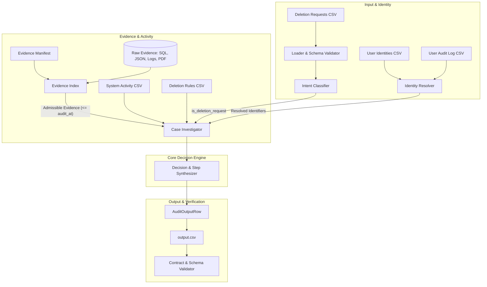

# Host Data Detector: System Architecture

## Overview

**Host Data Detector** is a deterministic, evidence-grounded audit engine designed to independently verify personal data deletion compliance across distributed systems. Rather than accepting reported workflow statuses or single-database deletion confirmations at face value, the system correlates historical user identities against multi-modal evidence (database replicas, search indexes, log streams, object exports, and backup records) up to an exact temporal audit cutoff.

---

## Component Architecture

---

## Module Responsibilities

### 1. `code/loader.py` — Schema Validation & Ingestion
- **Strict Parsing**: Reads CSV sources using UTF-8 with BOM handling (`utf-8-sig`).
- **Header Validation**: Validates presence of all mandatory columns per contract.
- **Identifier Integrity**: Enforces uniqueness of primary keys (`case_id`, `user_id`, `audit_id`, `activity_id`, `rule_id`, `file_id`) and catches blank identifier rows early.
- **Actionable Errors**: Emits descriptive exceptions (`SchemaValidationError`, `DuplicateIdentifierError`, `MissingIdentifierError`) with file name and line number.

### 2. `code/models.py` — Domain Models & Invariants
- Immutable dataclasses modeling domain entities:
  - `DeletionRequest`: Case parameters including `requested_at`, `reported_status`, and `audit_at`.
  - `UserIdentity` & `UserAuditEntry`: Current identity snapshot and historical field changes.
  - `DeletionRule`: Policy treatment by data category and condition.
  - `SystemActivity`: Distributed activity events and status claims.
  - `EvidenceFileRecord`: Manifest metadata for admissible evidence files.
  - `Step`: Individual audit finding, remediation action, or verification check.
  - `AuditOutputRow`: Final case assessment (`COMPLETE`, `INCOMPLETE`, `NOT_APPLICABLE`) and JSON serialized step pipeline.
- Defines contract invariants:
  - Exact 15 allowed operations: 4 finding, 5 remediation, 6 verification operations.
  - Mandatory phase transitions: `FINDING` $\to$ `REMEDIATION` $\to$ `VERIFICATION`.

### 3. `code/timestamp.py` — Temporal Cutoff & ISO-8601 Handling
- **Timezone Normalization**: Parses ISO-8601 strings, converting UTC offsets to a unified scale.
- **Temporal Cutoff Enforcement**: `is_at_or_before(timestamp, cutoff)` ensures strict isolation. Evidence captured strictly after `audit_at` is never evaluated for that case.

### 4. `code/identity.py` — Identity Resolution & Audit Trail Recovery
- **Multi-Identifier Graph**: Reconstructs current and historical emails, phone numbers, and SHA-256 email hashes for every subject by traversing `user_audit_log`.
- **Bidirectional Lookup**: Resolves subjects by current email, historical email, or stable `user_id`.
- **Search Key Generation**: Emits canonical identity sets for evidence scanners, preventing attribution leakage across users with similar names or email prefixes.

### 5. `code/classifier.py` — Intent Classification & Exception Handling
- **Regulatory Intent Separation**:
  - Authorizing requests: GDPR Article 17 (Right to Erasure / "forget me", permanent deletion, account deletion).
  - Non-authorizing requests: GDPR Article 15 (Right of Access / data export), Article 16 (Rectification / update info), Article 21 (Marketing opt-out / unsubscribe).
- **Multilingual Support**: Supports English, Spanish, French, German, Japanese, Korean (`삭제`, `영구 삭제`), and Portuguese (`exclusão permanente`, `apagar`).
- **Negative Pattern Scoping**: Prevents false positive classification when access or opt-out requests contain incidental words like "remove from mailing list" or "erase previous address".

### 6. `code/evidence.py` — Multi-Modal Evidence Indexing
- **Admissibility Filter**: Filters manifest files by temporal cutoff (`captured_at <= audit_at`).
- **In-Memory SQLite Execution**: Executes SQLite-compatible SQL snapshots in memory (`:memory:`) to inspect table structures, row counts, and column contents.
- **Structured JSON & Log Parsing**: Streams JSON snapshot bundles and applies regex pattern matching across application and gateway logs.
- **PDF Extraction**: Extracts textual layers from business documents and support attachments via `pypdf`.

### 7. `code/investigator.py` — State Reconciliation & Step Planning
- **Finding Generation**: Identifies policy violations, surviving records in replicas, exposed PII in tombstones, active sync connectors, and unblocked restore risks.
- **Dependency-Ordered Remediation**:
  1. `DISABLE_DATA_FLOW`: Disable active synchronization connectors first to prevent immediate data recreation.
  2. `BLOCK_RESTORE`: Block affected backups before modifying downstream replicas.
  3. `DELETE_RECORD` / `REDACT_RECORD` / `ANONYMIZE_RECORD`: Remediate surviving database, search, support, and analytics records.
- **Post-Remediation Verification Planning**:
  - Generates future verification checks for every remediated resource (`evidence_id=""`).
  - For `COMPLETE` cases, includes only evidence-backed verification checks proving compliant state at `audit_at` (`evidence_id` populated with file or activity ID).

### 8. `code/validator.py` — Output Contract Validator
- Independently verifies output files:
  - Exact row count and monotonic sorting by `case_id`.
  - Non-empty `steps_json` for `COMPLETE` and `INCOMPLETE`; empty `[]` for `NOT_APPLICABLE`.
  - 1-indexed consecutive step numbers starting at 1.
  - Phase sequence invariant: `FINDING` before `REMEDIATION` before `VERIFICATION`.
  - Operation-to-state validity mapping.
  - Grounding check: `evidence_id` must match a real file, activity, or audit ID for findings and complete-case verifications; must be empty for remediation and incomplete-case verifications.
