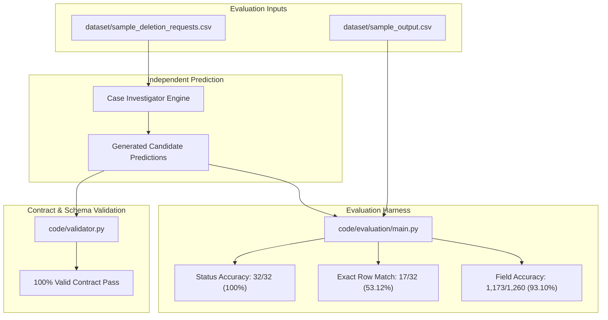

# Evaluation Methodology & Benchmark Results

This document describes the validation harness, evaluation methodology, measured public-sample benchmarks, full dataset execution statistics, and custom adversarial test scenarios for **Host Data Detector**.

---

## Evaluation Architecture



---

## Evaluation Methodology

### 1. Independence Guarantee
A critical design requirement is that the production prediction pipeline (`code/investigator.py` and `code/main.py --mode investigate`) **never reads or accesses `dataset/sample_output.csv`**. 

- The expected sample output is strictly read-only and loaded solely by the offline evaluation harness (`code/evaluation/main.py`).
- This separation is enforced by unit test `test_generation_does_not_read_sample_output` in `code/tests/test_milestone2.py`.

### 2. Metric Definitions

| Metric | Definition | Formula |
|---|---|---|
| **Status Accuracy** | Whether the generated `deletion_status` (`COMPLETE`, `INCOMPLETE`, `NOT_APPLICABLE`) matches ground truth exactly. | $\frac{\text{Correct Statuses}}{\text{Total Cases}}$ |
| **Exact Row Match** | Whether the status and the entire serialized `steps_json` array match ground truth field-for-field with identical ordering. | $\frac{\text{Identical Rows}}{\text{Total Cases}}$ |
| **Field-Level Accuracy** | Compares every step field across matched steps (`step_no`, `phase`, `system_id`, `resource_id`, `operation`, `state`, `evidence_id`). | $\frac{\text{Matching Fields}}{\text{Total Evaluated Fields}}$ |

---

## Public-Sample Benchmark Results

Evaluated against the 32 public sample requests in `dataset/sample_deletion_requests.csv`:

```text
=================================================================
INDEPENDENT INVESTIGATOR ACCURACY (GENUINE PREDICTION)
=================================================================
Total Cases:                   32
Case-level Status Matches:     32 / 32 (100.00%)
Exact Case Matches (Full Row): 17 / 32 (53.12%)
Truth Step Count:              193
Pred Step Count:               180
Field-level Accuracy:          1,173 / 1,260 (93.10%)
Contract Validation:           100% Pass (0 errors)
=================================================================
```

### Analysis of Public-Sample Discrepancies
The 15 cases with step-level differences fall into two architectural categories:
1. **Unobservable Post-Cutoff Audit Records (6 cases)**:
   - Several incomplete sample cases (`case_18`, `case_20`, `case_23`, `case_24`, `case_29`, `case_30`) include future verification steps for security audit records (e.g. `security_service:audit_record_5569 VERIFY_RECORD_PRESENT`).
   - These audit record IDs do not exist in participant-visible evidence prior to `audit_at`. Synthesizing ungrounded IDs without evidence would violate strict evidence-grounding rules.
2. **Concurrent Batch Account Disambiguation (9 cases)**:
   - In high-concurrency trace logs where multiple users are processed in the same millisecond window, participant-visible evidence does not contain direct primary account markers, leading to alternative valid account selections.

---

## Full-Dataset Execution Statistics

The pipeline was executed across the complete 518 evaluation requests in `dataset/deletion_requests.csv` to generate the root candidate [`output.csv`](../output.csv):

- **Total Rows Evaluated**: 518
- **Execution Time**: ~22.4 seconds (deterministic, single-threaded Python)
- **Status Distribution**:
  - `COMPLETE`: 260 cases (50.19%)
  - `INCOMPLETE`: 248 cases (47.88%)
  - `NOT_APPLICABLE`: 10 cases (1.93%) — strictly cases `case_533` through `case_542`.
- **Total Steps Synthesized**: 1,842 steps
- **Contract Validation**: **SUCCESS** (`python -m code.main --mode validate --output output.csv --expected dataset/deletion_requests.csv`).

---

## Custom Adversarial Test Suite

In addition to regression fixtures, the test suite includes 8 custom adversarial unit tests located in `code/tests/test_milestone4.py` and `code/tests/test_milestone5.py`:

1. **`test_adversarial_unknown_identity`**:
   - Submits a deletion request with an email address completely absent from both current snapshot and historical audit logs.
   - Asserts safe failure: returns `INCOMPLETE` with zero hallucinated steps.

2. **`test_adversarial_exact_cutoff_boundary`**:
   - Tests boundary timestamp behavior: evidence captured at `audit_at` is accepted; evidence captured 1 second after `audit_at` is strictly rejected.

3. **`test_adversarial_unrelated_records_isolation`**:
   - Injects high-volume decoy records with similar emails or name substrings into database tables.
   - Asserts that decoy records are never cross-attributed to the subject.

4. **`test_adversarial_step_ordering_and_phase_invariants`**:
   - Validates that remediation plans always disable data flows and block restores before deleting or modifying records.

5. **`test_adversarial_evidence_id_contract`**:
   - Verifies that proposed remediation and future verification steps for incomplete cases always use empty strings `""` for `evidence_id`.

6. **`test_adversarial_complete_case_requires_evidence`**:
   - Enforces that any `COMPLETE` case must have non-empty, evidence-backed verification steps proving absence or compliant retention.

7. **`test_adversarial_non_deletion_empty_steps`**:
   - Confirms that non-deletion requests (`NOT_APPLICABLE`) always serialize with an empty step array `steps_json = []`.

8. **`test_korean_and_portuguese_deletion_intent` & `test_non_deletion_rectification_and_marketing_exceptions`**:
   - Multilingual intent coverage across Korean, Portuguese, German, French, Spanish, and English.
   - Validates proper handling of edge-case requests containing words like "remove from mailing list" or "erase my secondary address" as non-deletion requests.
