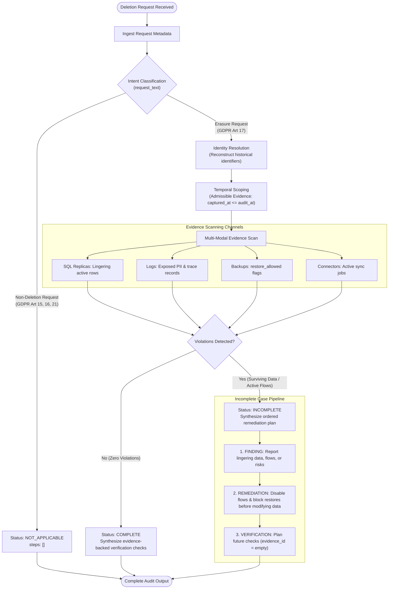

# Deletion Investigation Workflow

This document details the multi-stage decision pipeline used by **Host Data Detector** to audit deletion requests, uncover lingering "ghost data", formulate safe remediation sequences, and plan post-remediation verification.

---

## Investigation Lifecycle

---

## Detailed Pipeline Phases

### Phase 1: Intent Classification
Every request begins with an authorization check on `request_text`:
- **Regulatory Erasure**: Requests explicitly invoking GDPR Article 17, CCPA deletion, "forget my data", permanent account closure, or erasure are authorized for audit.
- **Exceptions (Non-Deletion)**:
  - GDPR Article 15: Right of access / personal data export requests.
  - GDPR Article 16: Rectification / address update / correction requests.
  - GDPR Article 21: Marketing opt-out, newsletter unsubscribe, or cookie preference updates.
- **Handling**: Non-deletion requests immediately terminate with status `NOT_APPLICABLE` and an empty step array `steps_json = []`.

### Phase 2: Multi-Identifier Resolution
Subjects frequently submit requests using an older email address or may have updated their contact details prior to deletion.
1. The resolver queries `user_identities.csv` for the current identity snapshot.
2. It scans `user_audit_log.csv` chronologically to collect every historical email, phone number, and hashed identifier ever associated with that `user_id`.
3. It builds a canonical search set combining:
   - Primary `user_id` (e.g. `user_042`)
   - Current and historical emails (e.g. `alice@work.com`, `alice@personal.org`)
   - Current and historical phone numbers
   - SHA-256 email hashes used by marketing and tracking systems.

### Phase 3: Temporal Scoping & Cutoff Isolation
Evidence must reflect the ground truth at `audit_at`:
- Any evidence file or activity log captured after `audit_at` is excluded from the investigation.
- Evidence captured prior to `requested_at` is treated as pre-deletion state and cannot be used to prove surviving ghost data unless verified as persistent post-deletion.

### Phase 4: Multi-Modal Evidence Investigation
The engine evaluates heterogeneous evidence files across distributed enterprise services:
- **Read & Failover Replicas (SQL)**: In-memory SQLite execution checks whether primary deletions propagated to read replicas, reporting replicas, and failover databases. Lingering active records in replica tables indicate replication lag or detached replica sync.
- **Object Storage & JSON Snapshot Bundles**: Evaluates structured account snapshots. Identifies whether account tombstones properly redacted names and emails while preserving the internal user key.
- **Connector Management & Event Logs**: Inspects recurring ETL and synchronization jobs. An active connector (`reported_result = ACTIVE`) scheduled after deletion is flagged as an active data flow risk.
- **Backup & Restore Consoles**: Checks snapshot manifests. If a backup containing the user's data has `restore_allowed = 1`, it poses a restore revival risk.
- **Audit & Security Registers (PDF / Logs)**: Legal retention registers and security access logs are verified to ensure required compliance records remain present (`VERIFY_RECORD_PRESENT`).

### Phase 5: Ordered Remediation & Verification Planning

When deletion is **`INCOMPLETE`**, remediation steps must be strictly ordered to prevent immediate data revival during execution:
1. **Inflow Prevention**:
   - `DISABLE_DATA_FLOW`: Disable active synchronization connectors first (`state: DISABLED`).
   - `BLOCK_RESTORE`: Block affected backup archives from restoring data (`state: BLOCKED`).
2. **Record Treatment**:
   - `DELETE_RECORD`: Permanently drop surviving rows in downstream replicas (`state: ABSENT`).
   - `REDACT_RECORD`: Strip exposed direct PII from surviving logs or handover documents (`state: REDACTED`).
   - `ANONYMIZE_RECORD`: Irreversibly unlink analytics profiles (`state: ANONYMIZED`).
3. **Post-Remediation Verification**:
   - For every remediated resource, schedule a future verification check (`VERIFY_RECORD_ABSENT`, `VERIFY_DATA_FLOW_DISABLED`, etc.) with `evidence_id = ""` (since future verification cannot cite historical evidence).

When deletion is **`COMPLETE`**:
- The output contains **only** evidence-backed verification steps proving the compliant state at `audit_at`.
- Every verification step must cite the participant-visible `evidence_id` (file, activity, or audit record) proving that the record is absent, redacted, or legitimately retained.
